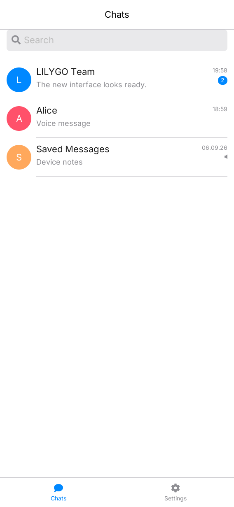
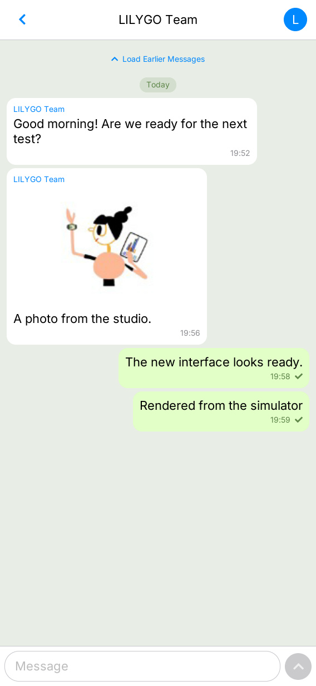
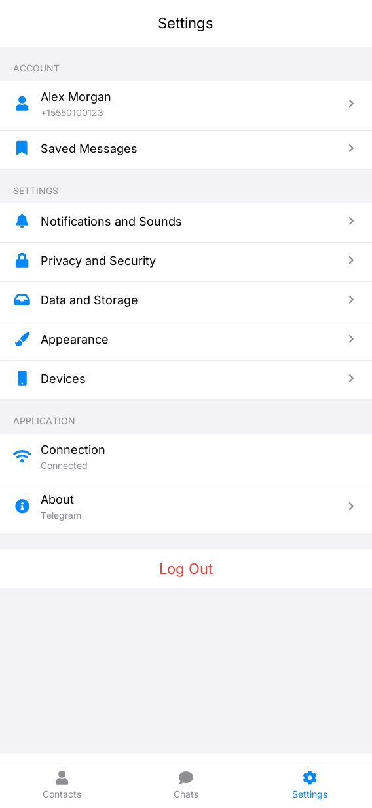

# LilyChat

**English** | [简体中文](README.zh-CN.md)

LilyChat is a lightweight, unofficial Telegram client for LILYGO UI. It is built
with C++17, [LILYGO UI AppKit](https://github.com/LILYGO-UI/cm0-appkit), LVGL 9.5,
and the TDLib JSON interface. It uses the Telegram API and is part of the
Telegram ecosystem, with no official affiliation or endorsement.

The project provides a CM0 ARM64 Linux build for devices with a quad-core 1 GHz
Cortex-A53 and 512 MB LPDDR2, plus an SDL2 desktop simulator for development
and testing. The display name is LilyChat; the package name
<code>lilygo-ui-telegram</code>, application ID <code>cc.lilygo.ui.Telegram</code>,
and data directory retain their existing identities for installation and data
compatibility.

## Preview

  
  
  

## Features

- **Account login:** Sign in to an existing Telegram account with a QR code or
  phone number, including email, verification-code, and two-step password flows.
- **Conversations:** Browse chats, load older messages, search cached chat names
  and last-message previews, and keep text drafts while switching chats or tabs.
- **Messages and media:** Send and receive plain text, download and display JPEG
  and PNG photos, and download and play Ogg Opus voice messages on Linux through
  ALSA. Circular avatars fall back to initials when unavailable.
- **Contacts and peer details:** Search and sort contacts, add contacts by phone
  number, remove contacts, open private chats, and view user, group, and channel
  profiles. Settings also provides access to Saved Messages.
- **Account settings:** Edit your name, username, and bio; configure notifications
  for private chats, groups, and channels; adjust privacy visibility settings.
- **Devices and storage:** Inspect login sessions, terminate other sessions,
  unblock users, view storage usage, clear local media, and choose photo
  auto-download and message font size.
- **Responsive interface:** Portrait and landscape layouts with Contacts, Chats,
  and Settings tabs, physical and on-screen keyboard input, and connection status.
  The visual design follows the classic light theme of Telegram for iOS.
- **Local demo:** A deterministic backend for UI development and tests without
  an account, TDLib, or a Telegram connection.

### Current Limitations

Video, animation, ordinary audio, and document previews are not supported, nor
are recording or sending voice messages, photos, or files. Registration,
in-app Telegram Premium purchase during login, editing, replying, forwarding,
remote or message-history search, calls, animated stickers, secret chats,
group member lists, and group administration are also outside the current scope.
Spoiler and self-destructing media display placeholders.

Privacy settings preserve existing user and group exceptions but cannot edit
those lists. Changing the two-step verification password or phone number,
deleting the account, and configuring proxies or system push notifications are
not currently available. Profile fields depend on Telegram's response and the
user's privacy permissions.

Local chat search covers at most 100 cached chats; contact search covers at most
500 loaded contacts and matches names, usernames, and phone numbers. Drafts live
only in memory for the current run and are cleared on logout or exit. A single
check on an outgoing message does not indicate that the recipient has read it.

The active conversation holds at most 80 messages. Decoded message photos are
limited to three images and 6 MiB in total, while voice audio is decoded in
chunks. These bounds are not a process RSS limit. See
[Telegram runtime and deployment](docs/02-telegram-runtime.md) for full resource
limits and [UI guidelines](docs/01-user-interface.md) for interaction details.

## Development Environment

Project identity, version, and package metadata come from
[lpm.toml](lpm.toml). [CMakePresets.json](CMakePresets.json) defines
host-simulator, host-telegram, and cm0-cross. Run all project commands from the
repository root.

### Get the Source

~~~sh
git clone --recurse-submodules https://github.com/LILYGO-UI/lilygo-ui-telegram.git
cd lilygo-ui-telegram
~~~

For an existing checkout, initialize the pinned dependencies:

~~~sh
git submodule update --init --recursive
~~~

AppKit is consumed directly from third_party/cm0-appkit; a separate AppKit
installation is not required for the simulator. The presets use its bundled
LVGL 9.5.0 archive and disable LVGL network fetching.

### Host Dependencies

Use CMake 3.21 or later (including CTest and CPack), Python 3.11 or later for
LPM, and a C/C++ compiler with C++17 support. The presets use Unix Makefiles;
AppKit also needs patch to apply its bundled LVGL patches. SDL2 supplies the
host display and FreeType supplies font rendering.

libjpeg is optional and enables background JPEG decoding, scaling, and
progressive JPEG support. Without it, the bundled LVGL baseline JPEG decoder
is used. Linux voice playback additionally requires ALSA and libopusfile runtime
libraries; missing voice libraries do not prevent login, text, or photo viewing.

#### Debian 12 / Ubuntu 24.04 or Later

~~~sh
sudo apt update
sudo apt install build-essential cmake git pkg-config patch libsdl2-dev \
  libfreetype6-dev libjpeg-dev ca-certificates python3 python3-venv python3-pip
~~~

#### macOS

Install the Xcode Command Line Tools if needed and dependencies through
[Homebrew](https://brew.sh/):

~~~sh
xcode-select --install
brew install git cmake pkg-config patch sdl2 freetype jpeg-turbo python
~~~

#### LPM

CMake invokes lpm metadata --format cmake during configuration. Install LPM
in a project-local environment using Python 3.11 or later:

~~~sh
python3 -m venv .venv
. .venv/bin/activate
python -m pip install "git+https://github.com/LILYGO-UI/lpm.git"
lpm --version
~~~

Reactivate the environment with . .venv/bin/activate in each new terminal.
CMake searches .venv/bin and PATH. An existing installation can be selected
with -DLPM_EXECUTABLE=/absolute/path/to/lpm during configuration.

### Device Cross Compiler

Skip this step when only building the desktop simulator. Device builds need a
separate AArch64 Linux cross compiler.

~~~sh
sudo apt install gcc-aarch64-linux-gnu g++-aarch64-linux-gnu
~~~

The BSP toolchain expects these executable names on PATH:

~~~sh
aarch64-linux-gnu-gcc --version
aarch64-linux-gnu-g++ --version
~~~

See [CM0BspBuilder](https://github.com/LILYGO-UI/CM0BspBuilder) for SDK host
and compiler requirements.

## Build and Test

LPM reads the build presets and package output directory from lpm.toml.
The default host preset uses demo data; host-telegram and the device preset use
the real TDLib backend by default.

### Desktop Simulator

~~~sh
TELEGRAM_DEMO=1 lpm start --foreground
~~~

To reuse an existing build, run TELEGRAM_DEMO=1 lpm start --no-build --foreground.
The Debug build has tests enabled and is stored in build/host-simulator.
Running the application requires a graphical desktop session. Account and
cloud-setting changes in demo mode affect only the current demo session.

### Connect to Telegram

Obtain api_id and api_hash from [my.telegram.org](https://my.telegram.org/) and
install or build a compatible [TDLib JSON shared library](https://github.com/tdlib/td#building).
The application loads TDLib at runtime with dlopen and requires the symbols
td_create_client_id, td_send, and td_receive.

~~~sh
cmake --preset host-telegram
cmake --build --preset host-telegram --parallel
TELEGRAM_DEMO=0 \
TELEGRAM_API_ID=123456 \
TELEGRAM_API_HASH=0123456789abcdef0123456789abcdef \
LILYGO_UI_TDJSON_LIBRARY=/absolute/path/to/libtdjson.so \
lpm start --preset host-telegram --no-build --foreground
~~~

Use libtdjson.dylib on macOS. Host configuration discovers
.cache/tdlib/install/lib/libtdjson.dylib or .so when no default path is set.
The runtime variable LILYGO_UI_TDJSON_LIBRARY takes precedence over
-DTELEGRAM_TDJSON_LIBRARY. TELEGRAM_DEMO=0 can select the real backend in a
demo build.

### Tests

~~~sh
lpm test
~~~

| Test | Coverage |
| --- | --- |
| telegram-json, telegram-model | JSON parsing and domain state |
| telegram-view-model | Commands, search, drafts, contacts, request validation, preferences, and resource bounds |
| telegram-image-decoder-limits, telegram-lvgl-photo-decoder | Image limits and optional baseline JPEG decoding |
| telegram-voice-identity | Voice playback identity and stale events |
| telegram-qr-login-ui, telegram-keyboard | Login switching, QR updates, and keyboard interaction |
| telegram-tdlib-mapping, telegram-tdlib-auth-restart | JSON mapping, auth restart, and stale auth events |
| telegram-tdlib-message-updates, telegram-tdlib-account | Message updates and account, contact, privacy, device, and storage operations |
| telegram-render-portrait, telegram-render-landscape | Rendering at 568 x 1232 and 1232 x 568 |

Render tests write telegram-portrait.ppm, telegram-landscape.ppm, and page
snapshots under build/host-simulator. Inspect both orientations after UI changes;
passing assertions alone does not verify visual layout.

### CM0 Device Build

The device preset targets AArch64 CM0 Raspberry Pi OS, uses Release, disables
host tests, and installs to /usr. Replace the example credentials before packaging:

~~~sh
TELEGRAM_API_ID=123456 \
TELEGRAM_API_HASH=0123456789abcdef0123456789abcdef \
lpm pack
~~~

CMake copies these values into empty caches and compiles them into the executable.
Later builds reuse nonempty cached values; update them with
-DTELEGRAM_API_ID=... and -DTELEGRAM_API_HASH=... when needed. Runtime
environment variables override the compiled defaults.

The first lpm pack downloads CM0 BSP 0.1.0, verifies its pinned SHA-256 checksum,
and extracts the sysroot to .cache/cm0-bsp/0.1.0/sysroot. CPack writes an ARM64
.deb to dist/. Real-backend packages depend on Debian 13's libtdjson1.8.38;
TDLib is not bundled. The package also requires lilygo-ui-appkit-dev >= 0.1.0,
libc6 >= 2.38, and libstdc++6 >= 14.1. Voice playback recommends libasound2
and libopusfile0. Use Debian 13 or an equivalent ABI.

Underlying CMake commands

~~~sh
cmake --preset host-simulator
cmake --build --preset host-simulator --parallel
ctest --preset host-simulator
~~~

~~~sh
cmake --preset cm0-cross -DTELEGRAM_DEMO=OFF
cmake --build --preset cm0-cross --parallel
cpack --config build/cm0-cross/CPackConfig.cmake -B dist
~~~

### Runtime Configuration and Data

| Variable | Purpose |
| --- | --- |
| TELEGRAM_DEMO | 1 forces demo, 0 forces TDLib; otherwise use the build default |
| TELEGRAM_DEMO_IMAGE | Override the demo image path |
| TELEGRAM_API_ID | Telegram application ID |
| TELEGRAM_API_HASH | Telegram application hash |
| TELEGRAM_DATABASE_KEY | Raw TDLib database encryption key |
| LILYGO_UI_TDJSON_LIBRARY | Absolute path to libtdjson |
| XDG_DATA_HOME | Override the application data root |

With XDG_DATA_HOME set, data is stored under:

~~~text
$XDG_DATA_HOME/lilygo-ui-telegram/database
$XDG_DATA_HOME/lilygo-ui-telegram/files
$XDG_DATA_HOME/lilygo-ui-telegram/ui-preferences.json
~~~

Otherwise the root is $HOME/.local/share/lilygo-ui-telegram/. Run only one
process per database directory. UI preferences contain message font size,
photo auto-download, and contact sorting; they do not contain credentials or
drafts. Clearing media cache removes local downloads without logging out.

### Troubleshooting

| Symptom | Action |
| --- | --- |
| LPM metadata error | Install LPM in .venv, put it on PATH, or set LPM_EXECUTABLE. |
| AppKit or LVGL missing | Run git submodule update --init --recursive. |
| SDL2 or FreeType missing | Install host packages; for device builds, check the sysroot. |
| TDLib cannot load | Check the library path, JSON symbols, architecture, and dependencies. |
| API ID/hash missing | Supply both values and ensure demo mode is disabled. |
| Photos are placeholders | Check download settings, connectivity, decoder support, and limits. |
| Voice does not play | On Linux, check ALSA, libopusfile, device permissions, and output selection. |

## Documentation

The detailed guides are currently in Chinese.

| Guide | Contents |
| --- | --- |
| [Telegram runtime and deployment](docs/02-telegram-runtime.md) | TDLib integration, credentials, resource limits, storage, and troubleshooting |
| [Project overview](docs/00-overview.md) | AppKit conventions, metadata, directory layout, and workflow |
| [UI development guidelines](docs/01-user-interface.md) | Telegram iOS references, layouts, typography, media, and visual validation |

## Acknowledgments

LilyChat uses [TDLib](https://github.com/tdlib/td), [LILYGO UI AppKit](https://github.com/LILYGO-UI/cm0-appkit),
[LVGL](https://lvgl.io/), libjpeg, ALSA, and libopusfile. Visual references come
from the [Telegram for iOS classic light theme](https://github.com/TelegramMessenger/Telegram-iOS/blob/6ad963e5b62d354da79040f388ae2b9132fb17b8/submodules/TelegramPresentationData/Sources/DefaultDayPresentationTheme.swift#L539).
The independent icon source is assets/app-icon.svg. Follow the relevant licenses
and [Telegram API terms](https://core.telegram.org/api/terms) when distributing a client.
