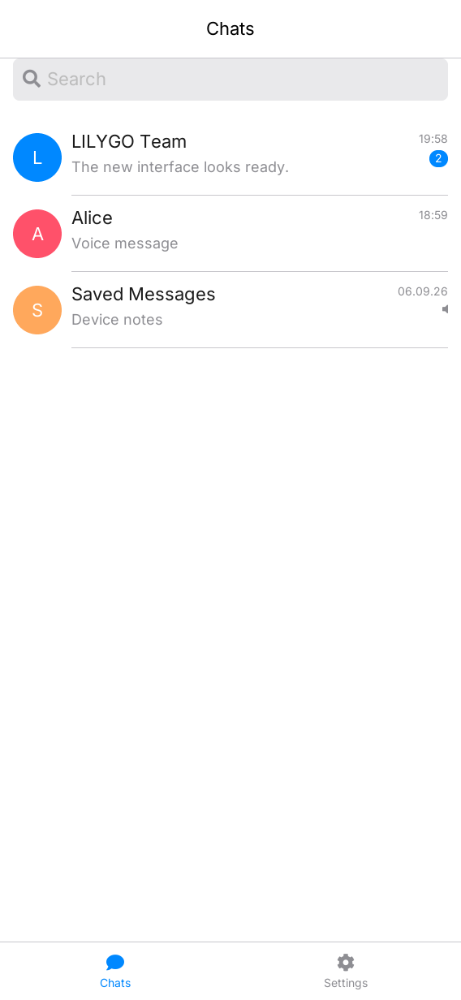
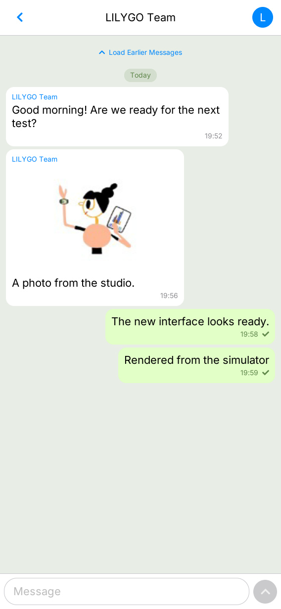
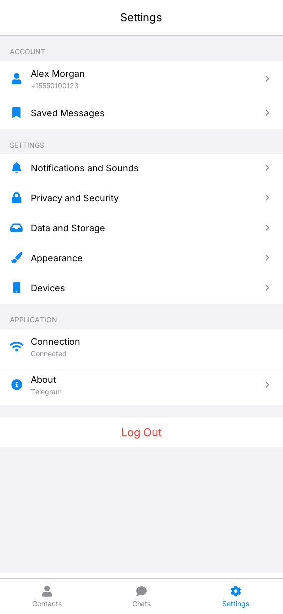

# LilyChat

[English](README.md) | **简体中文**

LilyChat 是面向 LILYGO UI 的轻量非官方 Telegram 客户端，基于 C++17、
[LILYGO UI AppKit](https://github.com/LILYGO-UI/cm0-appkit)、LVGL 9.5 和
TDLib JSON 接口构建。应用通过 Telegram API 接入 Telegram 生态，
与 Telegram 官方无隶属或背书关系。

项目提供面向四核 1 GHz Cortex-A53、512 MB LPDDR2 设备的 CM0 ARM64 Linux
构建，以及用于开发和测试的 SDL2 桌面模拟器。应用显示名称为 LilyChat；
包名 <code>lilygo-ui-telegram</code>、应用 ID
<code>cc.lilygo.ui.Telegram</code> 和数据目录沿用原标识，以保持安装和数据兼容。

## 预览

  
  
  

## 功能

- **账号登录：** 支持已有 Telegram 账号通过二维码或手机号登录，
  包括邮件、验证码和两步验证密码流程。
- **会话浏览：** 查看聊天列表、加载更早消息，在已缓存的会话名称和最后消息预览中
  搜索，并在切换会话或页签时保留文本草稿。
- **消息与媒体：** 收发纯文本，下载和显示 JPEG、PNG 图片，
  在 Linux 上通过 ALSA 下载并播放 Ogg Opus 语音。圆形头像不可用时回退到首字符。
- **联系人与详情：** 搜索和排序联系人，按手机号添加、删除联系人，打开私聊，
  查看用户、群组和频道资料；也可从设置进入 Saved Messages。
- **账号设置：** 修改姓名、用户名和简介；分别配置私聊、群组和频道通知；
  调整隐私可见范围。
- **设备与存储：** 查看登录设备、终止其他设备会话、解除屏蔽、查看存储用量、
  清理本机媒体缓存，设置照片自动下载和消息字号。
- **响应式界面：** 支持横竖屏布局，提供 Contacts、Chats、Settings 三个页签、
  实体键盘和屏幕键盘输入，以及连接状态。视觉设计参考 Telegram iOS 经典浅色主题。
- **本地演示：** 提供确定性演示后端，无需账号、TDLib 或 Telegram 连接即可开发和测试 UI。

### 当前限制

暂不支持视频、动画、普通音频和文档预览，也不支持录音或发送语音、图片、文件。
新账号注册、登录时购买 Telegram Premium、编辑、回复、转发、远程搜索、
消息历史搜索、通话、动态贴纸、secret chat、群成员名单和群组管理也不在当前范围。
剧透内容和阅后即焚媒体显示占位提示。

隐私设置会保留已有用户和群组例外，但不能编辑例外名单。当前也不提供两步验证
密码修改、手机号更换、账号删除、代理或系统推送通知配置。资料字段取决于
Telegram 返回的数据及用户的隐私权限。

本地会话搜索覆盖最多 100 个已缓存聊天；联系人搜索覆盖最多 500 位已加载联系人，
匹配姓名、用户名和手机号。草稿仅保存在当前运行期间的内存中，退出账号或应用后清空。
己方消息后的单勾不表示对方已读。

当前会话最多保留 80 条消息，已解码消息图片最多 3 张且合计不超过 6 MiB，
语音按块解码。这些限制不是整个进程的 RSS 上限。完整资源限制见
[Telegram 运行与部署](docs/02-telegram-runtime.md)，交互细节见
[UI 开发规范](docs/01-user-interface.md)。

## 开发环境搭建

项目标识、版本和软件包元数据由 [lpm.toml](lpm.toml) 提供。
[CMakePresets.json](CMakePresets.json) 定义了 host-simulator、host-telegram
和 cm0-cross。所有项目命令均在仓库根目录执行。

### 获取源码

~~~sh
git clone --recurse-submodules https://github.com/LILYGO-UI/lilygo-ui-telegram.git
cd lilygo-ui-telegram
~~~

已有仓库可使用以下命令初始化锁定版本的依赖：

~~~sh
git submodule update --init --recursive
~~~

项目直接使用 third_party/cm0-appkit，模拟器无需单独安装 AppKit。
各预设使用其中附带的 LVGL 9.5.0 源码归档，并禁用 LVGL 网络下载。

### 主机依赖

需要 CMake 3.21 或更高版本（包含 CTest 和 CPack）、供 LPM 使用的 Python 3.11
或更高版本，以及支持 C++17 的 C/C++ 编译器。预设使用 Unix Makefiles；
AppKit 还需要 patch 来应用附带的 LVGL 补丁。SDL2 提供主机显示，FreeType 负责字体渲染。

libjpeg 为可选依赖，可启用后台 JPEG 解码、缩放和 progressive JPEG 支持；
缺少它时使用附带的 LVGL baseline JPEG 解码器。Linux 语音播放还需要 ALSA
和 libopusfile 运行库；缺少语音库不会阻止登录、文本或图片功能启动。

#### Debian 12 / Ubuntu 24.04 或更高版本

~~~sh
sudo apt update
sudo apt install build-essential cmake git pkg-config patch libsdl2-dev \
  libfreetype6-dev libjpeg-dev ca-certificates python3 python3-venv python3-pip
~~~

#### macOS

按需安装 Xcode Command Line Tools，并通过 [Homebrew](https://brew.sh/) 安装依赖：

~~~sh
xcode-select --install
brew install git cmake pkg-config patch sdl2 freetype jpeg-turbo python
~~~

#### LPM

CMake 在配置阶段调用 lpm metadata --format cmake。使用 Python 3.11 或更高版本，
在项目虚拟环境中安装 LPM：

~~~sh
python3 -m venv .venv
. .venv/bin/activate
python -m pip install "git+https://github.com/LILYGO-UI/lpm.git"
lpm --version
~~~

每次打开新终端后重新执行 . .venv/bin/activate。CMake 会搜索 .venv/bin 和 PATH；
如需指定其他位置的 LPM，可在配置时传入 -DLPM_EXECUTABLE=/absolute/path/to/lpm。

### 设备交叉编译器

仅构建桌面模拟器时可跳过此步骤。设备构建需要单独安装 AArch64 Linux 交叉编译器：

~~~sh
sudo apt install gcc-aarch64-linux-gnu g++-aarch64-linux-gnu
aarch64-linux-gnu-gcc --version
aarch64-linux-gnu-g++ --version
~~~

SDK 对主机和编译器的要求详见 [CM0BspBuilder](https://github.com/LILYGO-UI/CM0BspBuilder)。

## 构建与测试

LPM 从 lpm.toml 读取构建预设和打包输出目录。默认主机预设使用演示数据；
host-telegram 和设备预设默认使用真实 TDLib 后端。

### 桌面模拟器

~~~sh
TELEGRAM_DEMO=1 lpm start --foreground
~~~

如需复用已有构建产物，执行 TELEGRAM_DEMO=1 lpm start --no-build --foreground。
Debug 构建启用测试，产物位于 build/host-simulator。运行应用需要图形桌面会话；
演示模式中的账号和云端设置修改只影响当前演示会话。

### 连接 Telegram

从 [my.telegram.org](https://my.telegram.org/) 申请 api_id 和 api_hash，
并安装或构建兼容的 [TDLib JSON 共享库](https://github.com/tdlib/td#building)。
应用通过 dlopen 在运行时加载 TDLib，共享库必须导出
td_create_client_id、td_send 和 td_receive。

~~~sh
cmake --preset host-telegram
cmake --build --preset host-telegram --parallel
TELEGRAM_DEMO=0 \
TELEGRAM_API_ID=123456 \
TELEGRAM_API_HASH=0123456789abcdef0123456789abcdef \
LILYGO_UI_TDJSON_LIBRARY=/absolute/path/to/libtdjson.so \
lpm start --preset host-telegram --no-build --foreground
~~~

macOS 使用 libtdjson.dylib。未设置默认路径时，主机配置会自动发现
.cache/tdlib/install/lib/libtdjson.dylib 或 .so。运行时变量
LILYGO_UI_TDJSON_LIBRARY 优先于 -DTELEGRAM_TDJSON_LIBRARY。
即使使用演示构建，也可以通过 TELEGRAM_DEMO=0 切换到真实后端。

### 测试

~~~sh
lpm test
~~~

| 测试 | 覆盖内容 |
| --- | --- |
| telegram-json、telegram-model | JSON 解析和领域状态 |
| telegram-view-model | 命令、搜索、草稿、联系人、请求校验、偏好及资源边界 |
| telegram-image-decoder-limits、telegram-lvgl-photo-decoder | 图片资源限制和可选的 baseline JPEG 解码器 |
| telegram-voice-identity | 语音播放身份与过期事件 |
| telegram-qr-login-ui、telegram-keyboard | 登录方式切换、二维码更新和实体键盘交互 |
| telegram-tdlib-mapping、telegram-tdlib-auth-restart | JSON 映射、认证重启和过期认证事件 |
| telegram-tdlib-message-updates、telegram-tdlib-account | 消息更新及账号、联系人、隐私、设备与存储操作 |
| telegram-render-portrait、telegram-render-landscape | 568 x 1232 和 1232 x 568 下的渲染与交互 |

渲染测试将 telegram-portrait.ppm、telegram-landscape.ppm 及页面快照写入
build/host-simulator。修改 UI 后应检查横竖屏产物；断言通过并不能验证视觉布局。

### CM0 设备构建

设备预设面向 AArch64 架构的 CM0 Raspberry Pi OS，使用 Release 构建，禁用主机测试，
并将安装前缀设为 /usr。替换示例 API 凭据后打包：

~~~sh
TELEGRAM_API_ID=123456 \
TELEGRAM_API_HASH=0123456789abcdef0123456789abcdef \
lpm pack
~~~

CMake 将这些环境变量填入尚未设置或为空的缓存，并编译进可执行文件。
后续构建会复用已有非空缓存；更换凭据时使用 -DTELEGRAM_API_ID=... 和
-DTELEGRAM_API_HASH=... 更新。运行时环境变量可覆盖内置默认值。

首次 lpm pack 会下载 CM0 BSP 0.1.0、校验锁定的 SHA-256，并将 sysroot 解压到
.cache/cm0-bsp/0.1.0/sysroot。CPack 将 ARM64 .deb 输出到 dist/。
真实后端包依赖 Debian 13 的 libtdjson1.8.38，不会捆绑 TDLib。
软件包还要求 lilygo-ui-appkit-dev >= 0.1.0、libc6 >= 2.38 和
libstdc++6 >= 14.1；语音播放建议安装 libasound2 和 libopusfile0。
请使用 Debian 13 或提供等价 ABI 的系统。

底层 CMake 命令

~~~sh
cmake --preset host-simulator
cmake --build --preset host-simulator --parallel
ctest --preset host-simulator
~~~

~~~sh
cmake --preset cm0-cross -DTELEGRAM_DEMO=OFF
cmake --build --preset cm0-cross --parallel
cpack --config build/cm0-cross/CPackConfig.cmake -B dist
~~~

### 运行配置与数据

| 变量 | 用途 |
| --- | --- |
| TELEGRAM_DEMO | 1 强制演示后端，0 强制 TDLib；未设置时使用构建默认值 |
| TELEGRAM_DEMO_IMAGE | 覆盖演示图片路径 |
| TELEGRAM_API_ID | Telegram 应用 ID |
| TELEGRAM_API_HASH | Telegram 应用 hash |
| TELEGRAM_DATABASE_KEY | TDLib 本地数据库原始加密密钥 |
| LILYGO_UI_TDJSON_LIBRARY | libtdjson 共享库绝对路径 |
| XDG_DATA_HOME | 覆盖应用数据根目录 |

设置 XDG_DATA_HOME 时，数据存放在：

~~~text
$XDG_DATA_HOME/lilygo-ui-telegram/database
$XDG_DATA_HOME/lilygo-ui-telegram/files
$XDG_DATA_HOME/lilygo-ui-telegram/ui-preferences.json
~~~

否则使用 $HOME/.local/share/lilygo-ui-telegram/。不要同时运行多个使用同一数据库
目录的进程。UI 偏好包含消息字号、照片自动下载和联系人排序，不包含凭据或草稿。
清理媒体缓存只回收本机下载文件，不会退出登录。

### 常见问题

| 现象 | 处理方法 |
| --- | --- |
| LPM 元数据错误 | 在 .venv 中安装 LPM，将其加入 PATH，或设置 LPM_EXECUTABLE。 |
| 找不到 AppKit 或 LVGL | 执行 git submodule update --init --recursive。 |
| 缺少 SDL2 或 FreeType | 安装主机开发依赖；设备构建时检查目标 sysroot。 |
| TDLib 无法加载 | 检查库路径、JSON 符号、CPU 架构和共享库依赖。 |
| API ID/hash 缺失 | 同时提供两项凭据，并确认未启用演示模式。 |
| 图片显示占位图 | 检查下载设置、网络、解码支持和资源限制。 |
| 语音无法播放 | 在 Linux 上检查 ALSA、libopusfile、设备权限和输出设备。 |

## 文档

详细指南目前均为中文。

| 指南 | 内容 |
| --- | --- |
| [Telegram 运行与部署](docs/02-telegram-runtime.md) | TDLib 接入、凭据、资源限制、数据存储和故障排查 |
| [项目总览](docs/00-overview.md) | AppKit 项目约定、元数据、目录结构和开发流程 |
| [UI 开发规范](docs/01-user-interface.md) | Telegram iOS 参考、布局、字体、媒体处理和视觉验收 |

## 致谢

LilyChat 通过 [TDLib](https://github.com/tdlib/td)、[LILYGO UI AppKit](https://github.com/LILYGO-UI/cm0-appkit)
和 [LVGL](https://lvgl.io/) 构建界面，并通过 libjpeg、ALSA 和 libopusfile 支持相应媒体功能。
视觉参考来自 [Telegram iOS 经典浅色主题](https://github.com/TelegramMessenger/Telegram-iOS/blob/6ad963e5b62d354da79040f388ae2b9132fb17b8/submodules/TelegramPresentationData/Sources/DefaultDayPresentationTheme.swift#L539)。
应用采用独立的对话气泡图标，矢量源文件为 assets/app-icon.svg。
分发客户端时请遵守相关许可及 [Telegram API 条款](https://core.telegram.org/api/terms)。
